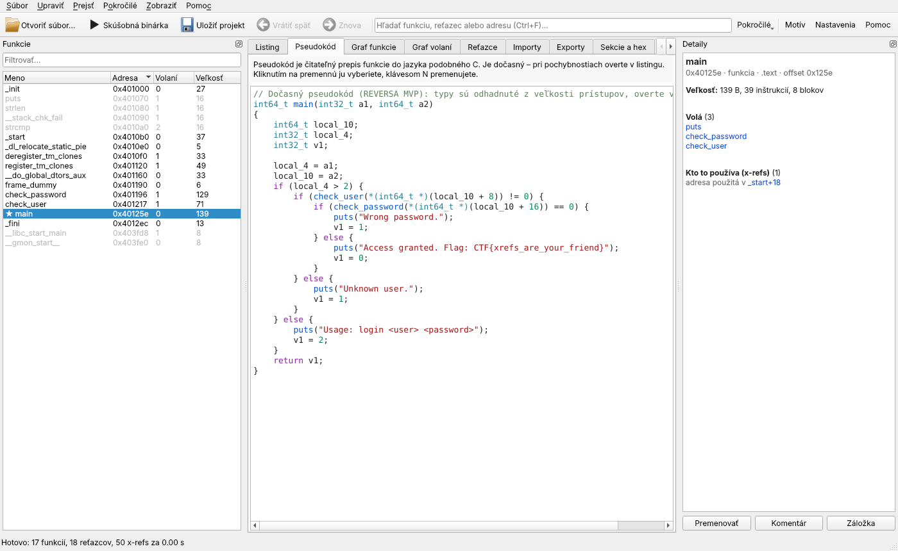

<p align="center">
  
</p>

<p align="center">
  <b>Open-source nástroj na reverzné inžinierstvo. Jednoduchý pre začiatočníkov, rýchly pre profesionálov.</b>
</p>

<p align="center">
  <a href="https://github.com/MrKniha/reversa/actions/workflows/ci.yml"></a>
  <a href="LICENSE"></a>
  
  
  
</p>

<p align="center">
  <a href="#inštalácia">Inštalácia</a> ·
  <a href="docs/quickstart.md">Rýchly štart</a> ·
  <a href="docs/tutorials.md">Tutoriály</a> ·
  <a href="docs/plugin-tutorial.md">Pluginy</a> ·
  <a href="#dokumentácia">Dokumentácia</a>
</p>

<p align="center">
  
</p>

## Čo REVERSA vie

- **Disassembler a pseudokód** pre x86, x86-64 a ARM64 (ARM 32-bit len disassembly).
- **Formáty** ELF, PE (32/64-bit) a surové dáta, napríklad firmvér.
- **Krížové odkazy, grafy funkcií a graf volaní.** Hneď vidíte, kto čo volá a kto číta ktorý reťazec.
- **Premenovanie, komentáre, záložky** s undo/redo. Všetko sa uloží do projektu `.rvproj`.
- **Pluginy a skripty v C/C++** cez stabilné C rozhranie.
- **Reporty** v Markdown, HTML a JSON, aj bez GUI (`reversa analyze`).
- **Rozhranie** po anglicky, slovensky, nemecky, francúzsky a čínsky. Svetlý aj tmavý motív.
- **Len statická analýza.** Súbor sa nikdy nespúšťa. Bez cloudu a bez telemetrie.

> Verzia 0.2.0. Pseudokód je zatiaľ **odhad**: typy sú odvodené z veľkosti prístupov.
> Dôležité závery si overte v listingu.

## Inštalácia

Hotové balíky sú na stránke [GitHub Actions](https://github.com/MrKniha/reversa/actions/workflows/ci.yml)
(posledný úspešný beh → *Artifacts*).

| Systém | Balík | Spustenie |
|---|---|---|
| **Windows** 10/11 (64-bit) | `reversa-windows-x64` (zip) | rozbaľte a spustite `bin\reversa-gui.exe` |
| **Linux** Ubuntu 24.04+, Debian 13+ | `reversa-linux-x64-deb` | `sudo apt install ./reversa_0.2.0_amd64.deb` |

Zostavenie zo zdrojov popisuje [docs/building.md](docs/building.md).

## Rýchly štart

```bash
reversa --demo                                   # ukážková CTF úloha so sprievodcom
reversa gui program.exe                          # vlastný súbor v GUI
reversa analyze program.elf --report report.md   # report bez GUI
reversa script strcmp_callers.so program.elf     # skript v C++
```

Za 10 minút nájdete v ukážke heslo: [docs/quickstart.md](docs/quickstart.md).

## Dokumentácia

| Dokument | Obsah |
|---|---|
| [Rýchly štart](docs/quickstart.md) | Prvá analýza, panely GUI, klávesové skratky |
| [Tutoriály](docs/tutorials.md) | Nájdite `main`, pochopte slučku, iné architektúry |
| [Skripty](docs/scripting-tutorial.md) a [pluginy](docs/plugin-tutorial.md) | Rozšírenia v C/C++ |
| [Zostavenie](docs/building.md) | Build zo zdrojov a testy |
| [Bezpečnosť a etika](docs/safety.md) | Bezpečná práca s malvérom, čo REVERSA nerobí |
| [Architektúra](docs/architecture.md) | Ako je REVERSA postavená, roadmapa |
| [Slovník](docs/glossary.md) | Pojmy pre začiatočníkov |
| [Výskum](docs/research.md) a [stav projektu](docs/status.md) | Porovnania s inými nástrojmi, akceptačné kritériá |

## Bezpečnosť a etika

REVERSA slúži na učenie, CTF, analýzu malvéru, bezpečnostný výskum a interoperabilitu.
**Neobsahuje a nebude obsahovať funkcie na obchádzanie DRM, licencií, aktivácie
ani anti-cheatu.** Podozrivé súbory analyzujte vo virtuálnom stroji bez siete.
Viac v [docs/safety.md](docs/safety.md). Zraniteľnosti hláste podľa [SECURITY.md](SECURITY.md).

## Prispievanie

Príspevky sú vítané. Pravidlá a postup sú v [CONTRIBUTING.md](CONTRIBUTING.md).

## Licencia

[MIT](LICENSE). Licencie komponentov tretích strán sú v [LICENSE-THIRD-PARTY](LICENSE-THIRD-PARTY).

## Poďakovanie

Učili sme sa z projektov Ghidra, radare2, Rizin, Cutter, angr, Detect It Easy, RetDec, LIEF a binwalk.
Strojový kód číta [Capstone](https://github.com/capstone-engine/capstone). Žiadny kód z týchto projektov
nie je skopírovaný, podrobnosti sú v [docs/research.md](docs/research.md).
