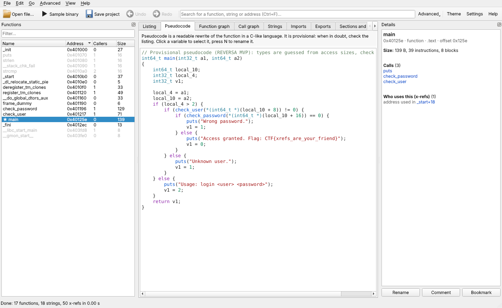

<p align="center">
  
</p>

<p align="center">
  <b>An open-source reverse engineering tool. Simple for beginners, fast for professionals.</b>
</p>

<p align="center">
  <a href="https://github.com/MrKniha/reversa/actions/workflows/ci.yml"></a>
  <a href="LICENSE"></a>
  
  
  
</p>

<p align="center">
  <a href="#installation">Installation</a> ·
  <a href="docs/quickstart.md">Quick start</a> ·
  <a href="docs/tutorials.md">Tutorials</a> ·
  <a href="docs/plugin-tutorial.md">Plugins</a> ·
  <a href="#documentation">Documentation</a>
</p>

<p align="center">
  
</p>

## What REVERSA does

- **Disassembler and pseudocode** for x86, x86-64 and ARM64 (ARM 32-bit: disassembly only).
- **Formats:** ELF, PE (32/64-bit) and raw data such as firmware.
- **Cross-references, function graphs and a call graph.** See at once who calls what and who reads which string.
- **Renames, comments, bookmarks** with undo/redo. Everything is saved to a `.rvproj` project.
- **Plugins and scripts in C/C++** over a stable C interface.
- **Reports** in Markdown, HTML and JSON, also without the GUI (`reversa analyze`).
- **Interface** in English, Slovak, German, French and Chinese. Light and dark theme.
- **Static analysis only.** The file is never run. No cloud, no telemetry.

> Version 0.2.0. The pseudocode is still an **estimate**: types are inferred from access sizes.
> Check important conclusions in the listing.

## Installation

Ready-made packages are on the [GitHub Actions](https://github.com/MrKniha/reversa/actions/workflows/ci.yml)
page (latest successful run, then *Artifacts*).

| System | Package | Run |
|---|---|---|
| **Windows** 10/11 (64-bit) | `reversa-windows-x64` (zip) | unpack and run `bin\reversa-gui.exe` |
| **Linux** Ubuntu 24.04+, Debian 13+ | `reversa-linux-x64-deb` | `sudo apt install ./reversa_0.2.0_amd64.deb` |

Building from source is described in [docs/building.md](docs/building.md).

## Quick start

```bash
reversa --demo                                   # sample CTF task with a guide
reversa gui program.exe                          # your own file in the GUI
reversa analyze program.elf --report report.md   # report without the GUI
reversa script strcmp_callers.so program.elf     # C++ script
```

Find the password in the demo in 10 minutes: [docs/quickstart.md](docs/quickstart.md).

## Documentation

| Document | Contents |
|---|---|
| [Quick start](docs/quickstart.md) | First analysis, GUI panels, keyboard shortcuts |
| [Tutorials](docs/tutorials.md) | Find `main`, understand a loop, other architectures |
| [Scripts](docs/scripting-tutorial.md) and [plugins](docs/plugin-tutorial.md) | Extensions in C/C++ |
| [Building](docs/building.md) | Build from source and tests |
| [Safety and ethics](docs/safety.md) | Working safely with malware, what REVERSA does not do |
| [Architecture](docs/architecture.md) | How REVERSA is built, roadmap |
| [Glossary](docs/glossary.md) | Terms for beginners |
| [Research](docs/research.md) and [project status](docs/status.md) | Comparisons with other tools, acceptance criteria |

## Safety and ethics

REVERSA is for learning, CTFs, malware analysis, security research and interoperability.
**It does not and will not contain features to bypass DRM, licenses, activation
or anti-cheat.** Analyse suspicious files in a virtual machine without a network.
More in [docs/safety.md](docs/safety.md). Report vulnerabilities as described in [SECURITY.md](SECURITY.md).

## Contributing

Contributions are welcome. Rules and steps are in [CONTRIBUTING.md](CONTRIBUTING.md).

## License

[MIT](LICENSE). Licenses of third-party components are in [LICENSE-THIRD-PARTY](LICENSE-THIRD-PARTY).

## Acknowledgements

We learned from Ghidra, radare2, Rizin, Cutter, angr, Detect It Easy, RetDec, LIEF and binwalk.
Machine code is read by [Capstone](https://github.com/capstone-engine/capstone). No code from these
projects is copied; details are in [docs/research.md](docs/research.md).
