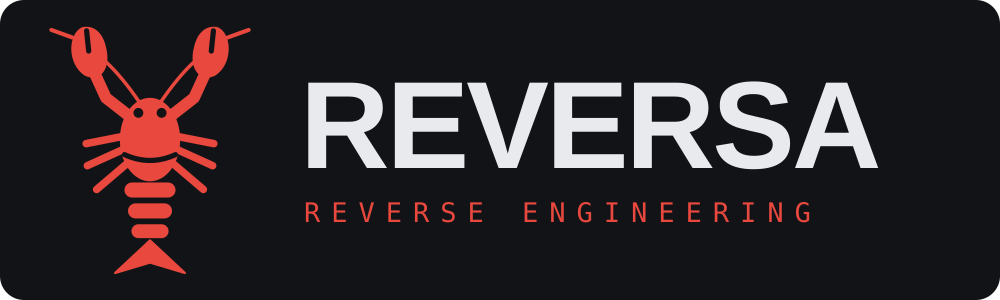

<p align="center"></p>

# REVERSA

**Open-source nástroj na reverzné inžinierstvo pre začiatočníkov aj profesionálov.**
Disassembler, pseudokód (dekompilátor), krížové odkazy (x-refs), grafy funkcií
a volaní, Python API, pluginy a natívne grafické rozhranie (Qt).

- Formáty: ELF, PE (32/64-bit), surové dáta (firmvér)
- Architektúry: x86, x86-64, AArch64 (ARM64), ARM 32-bit (len disassembly)
- Statická analýza: súbor sa **nikdy nespúšťa**. Bez cloudu, bez telemetrie.
- Platformy: **Windows a Linux** (64-bit)
- Jazyky GUI: angličtina (predvolená), slovenčina, nemčina, francúzština, čínština (zjednodušená)
- Napísané v **C++20** s grafickým rozhraním **Qt 6**; Python slúži len na skripty
  a pluginy. Prečo: [docs/architecture.md](docs/architecture.md#prečo-c-a-qt).
- Licencia: MIT

> Verzia 0.2.0. Pseudokód je **dočasný**: typy sú odhadnuté. Dôležité
> závery si overte v listingu. Známe obmedzenia sú v
> [docs/architecture.md](docs/architecture.md#známe-obmedzenia).

## Rýchly štart

Stiahnite hotový balík (nižšie) a spustite:

```bash
reversa --demo           # otvorí GUI s ukážkovou analýzou
```

Na Windows stačí dvojklik na `reversa-gui.exe`. Bez grafického prostredia:
`reversa --demo --no-gui`.

```bash
reversa gui program.exe                                   # GUI s vlastným súborom
reversa program.exe                                       # to isté, kratšie
reversa analyze program.elf --report report.md            # headless report (aj .html, --json)
reversa analyze program.elf --pseudocode main             # pseudokód jednej funkcie
reversa search program.elf --insn "call.*strcmp"          # hľadanie v inštrukciách
reversa script examples/scripts/strcmp_callers.py program.elf
reversa gui firmware.bin --arch arm64 --base 0x8000000    # surové dáta
```

## Prvá analýza za 10 minút

1. `reversa --demo`. Otvorí sa ukážkový program `login`, ktorý pýta meno a heslo.
   Pri prvom spustení vás privíta krátky sprievodca (5 krokov).
2. Vľavo kliknite na **★ main**, v strede na kartu **Pseudokód** (kláves `2`).
   `main` volá `check_user` a `check_password`.
3. Na karte **Reťazce** kliknite na `Wrong password.`. Panel **Detaily** vpravo
   ukáže, kto reťazec používa (x-refs).
4. Na karte **Importy** kliknite na `strcmp`. Volajú ho `check_user`
   a `check_password`. V ich pseudokóde nájdete meno aj heslo.
5. Premenujte funkciu (kláves `N`), vráťte zmenu (`Ctrl+Z`) a uložte projekt
   (`Ctrl+S`).

Celý postup s riešením: [docs/quickstart.md](docs/quickstart.md) a
[docs/tutorials.md](docs/tutorials.md).

## Ovládanie GUI

| Kláves | Akcia |
|---|---|
| `Ctrl+O` / `Ctrl+S` | otvoriť súbor alebo projekt / uložiť projekt |
| `Ctrl+F` | hľadať funkciu, reťazec alebo adresu |
| `G` | skočiť na adresu alebo meno |
| `1` `2` `3` `4` | listing, pseudokód, graf funkcie, graf volaní |
| `N` | premenovať funkciu, adresu alebo vybranú premennú v pseudokóde |
| `;` / `B` | komentár / záložka |
| `Ctrl+Z` / `Ctrl+Y` | späť / znova |
| `Alt+←` | späť v histórii navigácie |
| `Ctrl+Shift+T` | svetlý / tmavý motív |
| `F1` | úvodný sprievodca |

Všetky skratky zmeníte v *Zobraziť → Nastavenia*. Tam nastavíte aj veľkosť
písma, jazyk a vypnete vysvetlivky pre začiatočníkov. Predvolený jazyk je
angličtina; po zmene jazyka reštartujte REVERSA. Analýza beží na pozadí
a tlačidlom *Zrušiť* v stavovom riadku ju zastavíte.

## Inštalácia

### Hotové balíky

Na stránke GitHub Actions repozitára (posledný úspešný beh CI → *Artifacts*):

- **Windows:** `reversa-windows-x64` je zip. Rozbaľte ho kamkoľvek a spustite
  `reversa\bin\reversa-gui.exe` (GUI) alebo `reversa.exe` (príkazový riadok).
  Obsahuje Qt aj Python pre skripty a pluginy, nič ďalšie netreba inštalovať.
  Windows SmartScreen môže varovať, lebo súbor nie je digitálne podpísaný.
- **Linux (Ubuntu 24.04, Debian 13 a novšie):** `reversa-linux-x64-deb` obsahuje
  balík `.deb`:
  ```bash
  sudo apt install ./reversa_0.2.0_amd64.deb
  reversa --demo
  ```
  REVERSA sa objaví aj v ponuke aplikácií.

### Zostavenie zo zdrojov

Potrebujete C++20 kompilátor (GCC 11+, Clang 14+ alebo Visual Studio 2022),
CMake 3.21+, Qt 6.2+, SQLite 3 a Python 3.10+ (voliteľný, pre skripty
a pluginy). Capstone a pybind11 stiahne CMake automaticky v pevných verziách.

**Linux (Debian/Ubuntu):**

```bash
sudo apt install build-essential cmake ninja-build git qt6-base-dev libgl-dev libsqlite3-dev python3-dev
git clone https://github.com/MrKniha/reversa.git && cd reversa
cmake -S . -B build -G Ninja -DCMAKE_BUILD_TYPE=Release
cmake --build build
./build/bin/reversa --demo
```

Fedora: `sudo dnf install gcc-c++ cmake ninja-build qt6-qtbase-devel sqlite-devel python3-devel`.

**Windows:** nainštalujte Visual Studio 2022 (Desktop development with C++),
Qt 6 (Qt Online Installer, komponent MSVC 2022 64-bit), Python 3.12 z
python.org a vcpkg (`git clone https://github.com/microsoft/vcpkg` a
`bootstrap-vcpkg.bat`). V „x64 Native Tools Command Prompt":

```bat
git clone https://github.com/MrKniha/reversa.git && cd reversa
cmake -S . -B build -A x64 -DCMAKE_TOOLCHAIN_FILE=C:\vcpkg\scripts\buildsystems\vcpkg.cmake ^
      -DVCPKG_TARGET_TRIPLET=x64-windows-static-md -DCMAKE_PREFIX_PATH=C:\Qt\6.8.3\msvc2022_64
cmake --build build --config Release
build\bin\reversa.exe --demo
```

Voľby CMake: `-DREVERSA_GUI=OFF` (len príkazový riadok, bez Qt),
`-DREVERSA_PYTHON=OFF` (bez skriptov a pluginov), `-DREVERSA_TESTS=OFF`.

### Testy

```bash
ctest --test-dir build --output-on-failure            # C++ testy a GUI test (Qt offscreen)
python3 -m venv .venv && .venv/bin/pip install --require-hashes -r tests/requirements-dev.lock
REVERSA_BUILD_DIR=build .venv/bin/python -m pytest tests/python   # Python API, CLI, golden súbory
python3 scripts/headless_check.py build/bin/reversa   # end-to-end kontrola všetkých vzoriek
python3 scripts/check_licenses.py                     # licencie závislostí
python3 scripts/i18n.py check                         # úplnosť prekladov GUI
```

Na vývoj pozri [CONTRIBUTING.md](CONTRIBUTING.md).

### Python API mimo aplikácie

Modul sa zostaví spolu s programom do `build/bin/python`:

```bash
PYTHONPATH=build/bin/python python3 -c "import reversa; p = reversa.open('samples/bin/login_x64.elf'); print([f.name for f in p.callers_of('strcmp')])"
```

## Bezpečná analýza malvéru

REVERSA robí iba statickú analýzu. Súbor číta, ale nespúšťa. Napriek tomu
pri práci s podozrivými súbormi dodržujte tieto pravidlá:

1. **Pracujte vo virtuálnom stroji** (VirtualBox, VMware, QEMU/KVM), nie na
   svojom bežnom počítači. Pred analýzou si spravte snapshot.
2. **Odpojte sieť** virtuálneho stroja alebo použite izolovanú sieť
   (host-only). Malvér môže kontaktovať riadiace servery.
3. **Nikdy súbor nespúšťajte** mimo izolovaného prostredia. Ani „len na skúšku".
4. **Premenujte súbory** tak, aby sa nedali omylom spustiť (napr.
   `vzorka.exe_` alebo `vzorka.bin`). Archívy so vzorkami chráňte heslom
   (konvencia `infected`).
5. **Nezdieľajte priečinky** medzi hostiteľom a VM, kým to nepotrebujete.
   Vypnite automatické otváranie súborov a náhľady.
6. **Pozor na skripty a pluginy.** Bežia bez sandboxu. Nepoužívajte pluginy
   z neznámych zdrojov.
7. **Overte si hash** (SHA-256) vzorky pred a po analýze. REVERSA ho ukazuje
   v reporte, v tooltipe stavového riadku GUI a ukladá ho do projektu.
8. **Poškodené súbory sú v poriadku.** REVERSA načíta, čo sa dá, a ohlási
   chyby v diagnostike (*Pokročilé → Diagnostika načítania*). Nespadne.
9. **Dodržujte zákony a pravidlá organizácie.** Vzorky malvéru neposielajte
   ďalej mimo dôveryhodných kanálov (napr. CSIRT, výrobca antivírusu).

Do tohto repozitára nikdy nepridávajte malvér ani binárky bez zdrojového kódu.
Ukážky v `samples/` sú vlastné malé programy so zdrojmi v `samples/src/`.

## Etika

REVERSA slúži na učenie, CTF súťaže, analýzu malvéru, bezpečnostný výskum,
interoperabilitu a ladenie vlastného softvéru.

**REVERSA neobsahuje a nikdy nebude obsahovať funkcie na obchádzanie DRM,
licenčných kontrol, aktivácie, anti-cheat systémov alebo ochrany proti
kopírovaniu.** Takéto príspevky neprijmeme.

**Hranica patch módu:** budúci patch mód (roadmapa, nie je v 0.2.0) bude určený
na úpravy **vlastných** programov alebo programov, na ktoré máte povolenie:
opravy chýb, výučba, CTF úlohy. Nebude obsahovať automatické „crackovanie",
hľadanie a odstraňovanie licenčných kontrol ani podobné funkcie. Za to, ako
nástroj použijete, zodpovedáte vy. Analyzujte iba softvér, na ktorý máte právo.

## Dokumentácia

| Dokument | Obsah |
|---|---|
| [docs/quickstart.md](docs/quickstart.md) | Rýchly štart za 10 minút |
| [docs/tutorials.md](docs/tutorials.md) | Tutoriály: prvá analýza, nájdite `main`, pochopte slučku, iné architektúry |
| [docs/scripting-tutorial.md](docs/scripting-tutorial.md) | Python API a skripty |
| [docs/plugin-tutorial.md](docs/plugin-tutorial.md) | Ako napísať plugin |
| [docs/glossary.md](docs/glossary.md) | Slovník pojmov |
| [docs/architecture.md](docs/architecture.md) | Architektúra, rozhodnutia, roadmapa |
| [docs/research.md](docs/research.md) | Výskum, porovnania, záznam REA |
| [docs/status.md](docs/status.md) | Stav projektu a akceptačné kritériá |

## Licencia

REVERSA je pod licenciou **MIT**, pozri [LICENSE](LICENSE). Licencie
komponentov tretích strán sú v [LICENSE-THIRD-PARTY](LICENSE-THIRD-PARTY).
Skript `scripts/check_licenses.py` ich kontroluje v CI.

## Poďakovanie

Ďakujeme autorom projektov, z ktorých sme sa učili: Ghidra, radare2, Rizin,
Cutter, angr, Capstone, Detect It Easy, RetDec, LIEF, pyelftools, pefile,
binwalk a dagre. Zvlášť ďakujeme tímu **Capstone**, bez ktorého by REVERSA
nevedela čítať strojový kód. radare2 nám slúžil na nezávislú kontrolu výsledkov.

## Výskum a referencie

Podrobnosti, hviezdičky, dátumy a záznam použitia REA sú v
[docs/research.md](docs/research.md). Žiadny kód z týchto projektov nie je
v REVERSA skopírovaný.

| Projekt | URL | Licencia | Čo sme prebrali |
|---|---|---|---|
| Ghidra | https://github.com/NationalSecurityAgency/ghidra | Apache-2.0 | IR medzi assemblerom a pseudokódom, rozdelenie pohľadov, manifest rozšírení |
| radare2 | https://github.com/radareorg/radare2 | LGPL-3.0 | Krátke skratky. Nezávislá kontrola výsledkov |
| Rizin | https://github.com/rizinorg/rizin | LGPL-3.0 | Projekt ako súbor s verziou schémy |
| Cutter | https://github.com/rizinorg/cutter | GPL-3.0 | Rozloženie GUI, synchronizácia pohľadov |
| angr | https://github.com/angr/angr | BSD-2-Clause | Rekurzívny zostup, noreturn funkcie, Python API |
| Capstone | https://github.com/capstone-engine/capstone | BSD-3-Clause | **Závislosť**: disassembler |
| Detect It Easy | https://github.com/horsicq/Detect-It-Easy | MIT | Detekcia kompilátora a packera |
| RetDec | https://github.com/avast/retdec | MIT | Fázy dekompilácie, označenie výstupu ako odhad |
| LIEF | https://github.com/lief-project/LIEF | Apache-2.0 | Jednotný model binárky |
| pyelftools | https://github.com/eliben/pyelftools | Unlicense | Porovnanie s vlastným ELF parserom |
| pefile | https://github.com/erocarrera/pefile | MIT | Porovnanie s vlastným PE parserom |
| binwalk | https://github.com/ReFirmLabs/binwalk | MIT | Surové dáta s ručnou architektúrou a bázou |
| dagre | https://github.com/dagrejs/dagre | MIT | Algoritmus vrstveného rozloženia grafov |
| Unicorn, Keystone | https://github.com/unicorn-engine/unicorn, https://github.com/keystone-engine/keystone | GPL-2.0 | Nič (len roadmapa, voliteľne) |
| Zydis, iced | https://github.com/zyantific/zydis, https://github.com/icedland/iced | MIT | Nič (zvažované alternatívy k Capstone) |
| Frida, pwndbg | https://github.com/frida/frida, https://github.com/pwndbg/pwndbg | wxWindows / MIT | Nič (dynamická analýza je mimo MVP) |
| REA | `npx rea-agents` | — | Inšpekcia artefaktov. Plná analýza nebola možná bez Ghidry |
